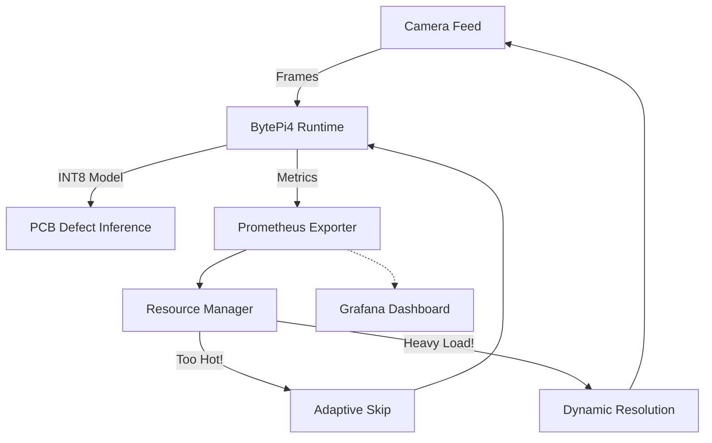

<div align="center">
  
  
  
  

  <!-- Animated Glowing Heading using readme-typing-svg -->
  <a href="https://git.io/typing-svg">
    
  </a>
  
  **Ultimate Real-Time YOLO Inference & Hardware Management for PCB Defect Detection**

  
  <br><br>

  <!-- Premium Powered By Logos -->
  <div>
    
    
    
  </div>
  <br>

  [](https://opensource.org/licenses/MIT)
  [](https://www.python.org/downloads/)
  [](https://github.com/ultralytics/ultralytics)
  [](https://prometheus.io/)
  [](https://grafana.com/)
  
  [**Explore the Docs**](#-architecture) · [**Report Bug**](#) · [**Request Feature**](#)
  
</div>

---

<div align="center">
  <h3> Built for the <b>Next Byte Hacks V5</b> </h3>
</div>

---

##  What is BytePi4?

**BytePi4** is a high-performance, dynamic runtime engine tailored for running heavy AI workloads—specifically customized for **PCB Defect Detection**—on resource-constrained ARM devices such as the Raspberry Pi 4. It intelligently balances performance and thermal constraints using real-time telemetry!

> **Why BytePi4?** Edge devices easily overheat and throttle when running continuous neural networks for industrial inspections. BytePi4 solves this by automatically tuning resolution, frame skipping, and CPU load on the fly, ensuring your PCB defect models run reliably 24/7!

---

##  Key Features

| Feature | Description |
| :--- | :--- |
|  **PCB Defect Inference** | Seamlessly runs custom `best_int8.tflite` PCB defect detection models via Ultralytics. |
|  **Thermal & Resource Management** | Automatically throttles inference if CPU/Memory usage or Temperature reaches critical thresholds. |
|  **Dynamic Resolution** | Auto-scales camera feed resolution (from 640x480 down to 320x240) based on system stress. |
|  **Adaptive Frame Skipping** | Drops frames intelligently to maintain system stability during heavy industrial load spikes. |
|  **Prometheus Integration** | Built-in Prometheus exporter for live dashboards monitoring FPS, latency, memory, and temperature. |

---

##  Interactive Gallery & PCB Demos

Check out BytePi4 in action! *(Hover and click images in your repository)*

<div align="center">
  <table>
    <tr>
      <td align="center"><br/><b>Action Shot 1</b></td>
      <td align="center"><br/><b>Action Shot 2</b></td>
      <td align="center"><br/><b>Action Shot 3</b></td>
    </tr>
    <tr>
      <td align="center"><br/><b>Dashboard / Telemetry</b></td>
      <td align="center"><br/><b>Hardware Setup</b></td>
      <td align="center"><br/><b>Real-time Detection</b></td>
    </tr>
  </table>
</div>

<details>
<summary>👉 <b>Click to expand more images!</b></summary>
<br/>
<div align="center">
  
  
  
</div>
</details>

---

##  Architecture



---

##  Quick Start

### 1. Clone & Setup
```bash
git clone https://github.com/SanjayG-xls/BytePi4.git
cd BytePi4
pip install -r requirements.txt
bash create_structure.sh
```

### 2. Run the Engine
Fire up the main runtime script:
```bash
python scripts/run_runtime.py
```

### 3. Run PCB Defect Inference Test
Test the camera and YOLO optimization explicitly:
```bash
python test_yolo.py
```

---

##  Dashboard & Monitoring

BytePi4 exposes metrics via Prometheus. Check `configs/optimization.yaml` to adjust thresholds!

- **CPU & Mem**: Low < 40%, High > 75%, Critical > 90%
- **Temperature**: Warning > 70°C, Critical > 80°C
- **Resolution Levels**: `[640, 480]`, `[512, 384]`, `[480, 360]`, `[320, 240]`

<br>

<div align="center">
  <table border="1" style="border-collapse: collapse; width: 100%;">
    <tr>
      <td align="center" width="20%">
        <br>
        <br>
        <br><b>Grafana Integrated</b><br><br>
      </td>
      <td padding="20px">
        <h2> The Grafana Command Center</h2>
        <p>BytePi4 natively streams all telemetry to <b>Grafana</b> via our Prometheus exporter! You can easily build dashboards to visualize:</p>
        <ul>
          <li> <b>Real-Time PCB Defect Counts</b> & Inference Confidence</li>
          <li> <b>Latency Spikes & FPS Graphs</b></li>
          <li> <b>Thermal Heatmaps & Resource Exhaustion</b></li>
          <li> <b>Dynamic Resolution Scaling Events</b></li>
        </ul>
        <p><i>It's a complete mission control box for your factory floor, giving you full observability over your edge devices!</i></p>
      </td>
    </tr>
  </table>
</div>

---

##  The Team

This project was built with  for the **Next Byte Hacks V5** by our fantastic team:

| **Sanjay G** | 
| **Vignesh B** |

---

##  Contributing
Feel free to fork this project, submit pull requests, or send us pictures of your own BytePi4 setups!

<div align="center">
  <b>BytePi4 Optimization Engine</b>
</div>
